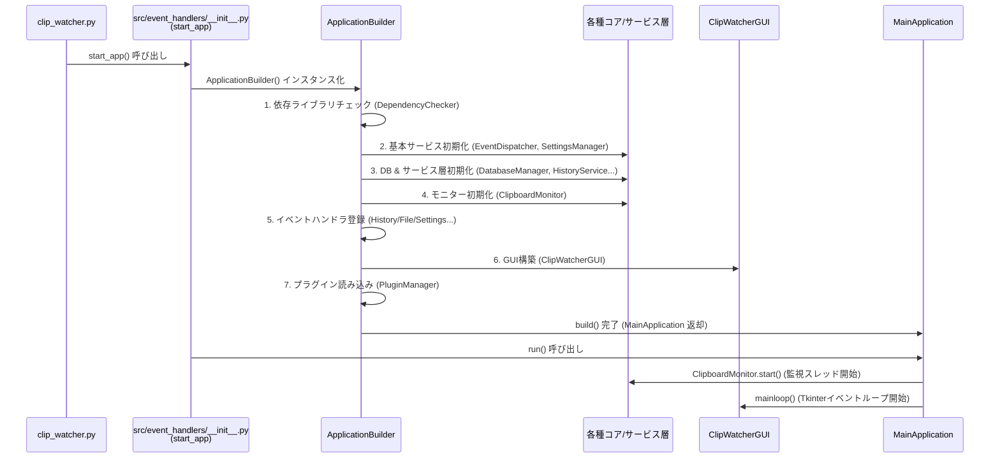
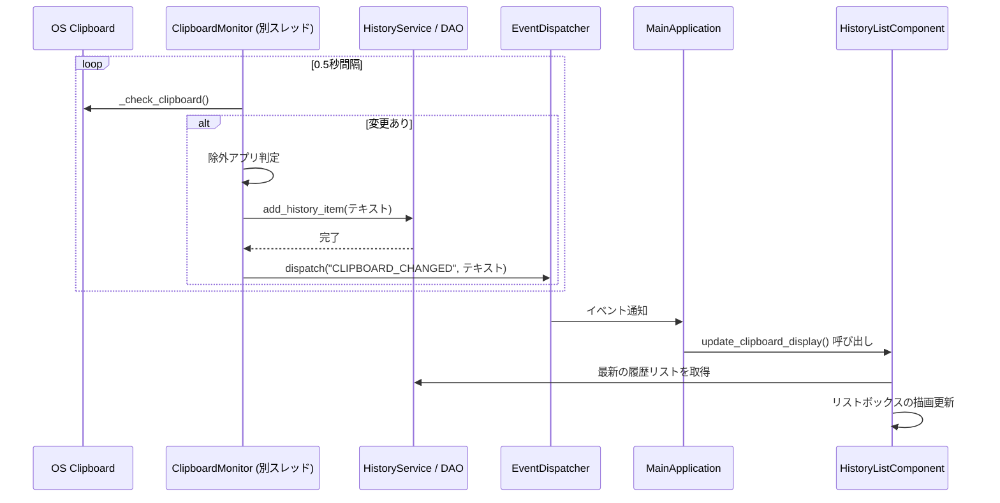
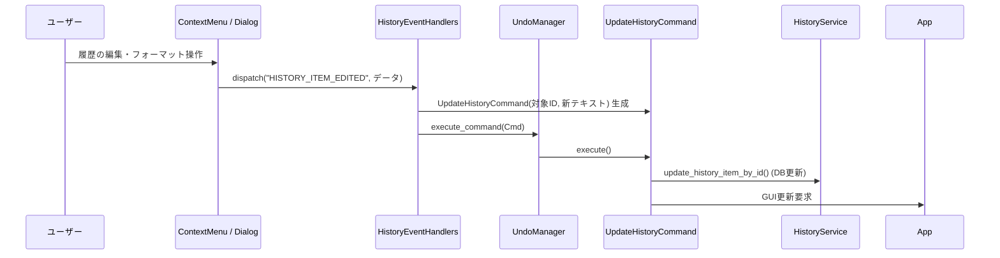

# 詳細設計書（コア層起動監視イベント制御）
**起動配線、監視フロー、イベント・コマンド制御の設計契約**

| 項目           | 内容                                               |
| :------------- | :------------------------------------------------- |
| 文書番号       | CLW-DD-002                                         |
| ファイル名     | CLW-DD-002_コア層起動監視イベント制御詳細設計書.md |
| ドキュメント名 | コア層起動監視イベント制御詳細設計書               |
| 版数           | Rev.1.0                                            |
| 改訂日         | 2026-08-31                                         |
| 作成日         | 2026-08-31                                         |
| 作成者         | 未記載                                             |

---

## 1. 概要とSSOT境界

本書は、`src/core/` 配下のコアモジュール群がアプリケーションを起動・制御する際の責務と連携契約を定義します。全体の責務境界は [CLW-BD-001_ClipWatcher全体アーキテクチャ基本設計書.md](CLW-BD-001_ClipWatcher全体アーキテクチャ基本設計書.md) を正本とします。

## 2. コア層のモジュール構成

コア層は、関心の分離（Separation of Concerns）に基づき、以下のサブパッケージに分割されています。

| サブパッケージ | 主な役割と構成クラス                                                                                                                                                                                                                                                                                                                                                                                                     |
| :------------- | :----------------------------------------------------------------------------------------------------------------------------------------------------------------------------------------------------------------------------------------------------------------------------------------------------------------------------------------------------------------------------------------------------------------------- |
| `bootstrap/`   | **起動と依存関係の構築** ・`ApplicationBuilder`: 各サービス・UIを生成し依存性を注入（DI）する。 ・`BaseApplication`: アプリケーションの基底インターフェース。 ・`DependencyChecker`: 起動前の環境・依存ライブラリのチェック。                                                                                                                                                                                   |
| `clipboard/`   | **OSクリップボード監視** ・`ClipboardMonitor`: OSのクリップボード変更を常時監視し、変更検知時にイベントを発行する。                                                                                                                                                                                                                                                                                                   |
| `events/`      | **イベント駆動と状態遷移** ・`EventDispatcher`: Pub/Subモデルによるコンポーネント間通信のハブ。 ・`commands.py`: Undo/Redo機能のためのコマンドパターン実装（`UpdateHistoryCommand`等）。                                                                                                                                                                                                                           |
| `config/`      | **設定管理と状態** ・`SettingsManager`: `settings.json` の読み書き。 ・`AppStatus`: アプリ全体の状態保持。                                                                                                                                                                                                                                                                                                         |
| `platform/`    | **OS抽象化・アダプター**（詳細は§6） ・`protocols.py`: OS抽象インターフェース群（`ProcessInspector`, `SoundPlayer`, `ClipboardReader`等）。 ・`services.py`: OS実装の選択を一元化する `PlatformServices`。 ・`errors.py`: `PlatformError` / `UnsupportedFeatureError` / `SingleInstanceError`。 ・`windows/`: Windows具象アダプター。 ・`null/`: ホットキー用の暫定Nullアダプターのみ（#150で廃止予定）。 |
| `app_main.py`  | `BaseApplication` を実装する具象クラス。ビルドされたシステムを統括する。                                                                                                                                                                                                                                                                                                                                                 |

---

## 3. アプリケーション起動フロー (Bootstrap Flow)

アプリケーションの起動は、エントリーポイント (`clip_watcher.py`) から `start_app()` 関数を介して開始され、`ApplicationBuilder` によって段階的に構築されます。

### 起動時のポイント

- **DI (依存性注入)**: サービスやハンドラは互いに直接インスタンス化せず、`ApplicationBuilder` が必要なオブジェクト（`EventDispatcher` など）をコンストラクタ経由で渡します。これにより循環参照を防いでいます。

---

## 4. クリップボード監視フロー (Monitoring Flow)

バックグラウンドで動作する `ClipboardMonitor` がクリップボードの変更を検知し、それが GUI に反映されるまでのフローです。

**【監視フローのポイント】**
- `ClipboardMonitor` は別スレッドで稼働しますが、直接 GUI を操作しません。`EventDispatcher` を介してイベントを発行することで、Tkinterのメインスレッド（`MainApplication` 側）で安全に描画更新が行われます。

---

## 5. イベント・コマンド制御フロー (Control Flow)

ユーザーが GUI からアクションを起こした際のフローです（例：履歴のフォーマット適用や編集）。

**【制御フローのポイント】**
- 操作はすべて `src/event_handlers/` 内のハンドラで受け止めます。
- 状態を変更する操作（更新、削除など）は `src/core/events/commands.py` に定義されたコマンドオブジェクトにカプセル化されます。これにより、将来的に `undo()` メソッドを呼ぶだけでデータベースと GUI の状態を元に戻すことができます。

## 6. プラットフォーム抽象レイヤー設計 (#158)

OSごとに実装が異なる機能は `src/core/platform/` に隔離し、**どのOSでどの実装を使うかの選択は `PlatformServices` の1箇所**に集約します。各クラスが `sys.platform` で分岐して自前でアダプターを生成することは行いません。

### 6.1 対象範囲

| 区分               | 機能                                                                                                | 扱い                                                                                                                                                  |
| :----------------- | :-------------------------------------------------------------------------------------------------- | :---------------------------------------------------------------------------------------------------------------------------------------------------- |
| 本設計の対象       | `ProcessInspector` / `SoundPlayer` / `SingleInstanceController` / `PasteSender` / `ClipboardReader` | `PlatformServices` から取得する。                                                                                                                     |
| 対象外（暫定維持） | `HotkeyListener`                                                                                    | Windows限定。`ApplicationBuilder.with_global_hotkey_listener()` の分岐と `NullHotkeyListener` を #150 まで維持する。                                  |
| 対象外             | macOS / Linux 向け `ClipboardReader` の具象実装                                                     | 実機確認が必要なため #170 で扱う。                                                                                                                    |
| 対象外             | GUI描画・テーマ制御                                                                                 | [CLW-DD-004_マルチプラットフォームGUI描画とテーマ制御詳細設計書.md](CLW-DD-004_マルチプラットフォームGUI描画とテーマ制御詳細設計書.md) を正本とする。 |

### 6.2 `PlatformServices` の契約

| 項目     | 仕様                                                                                                                                                         |
| :------- | :----------------------------------------------------------------------------------------------------------------------------------------------------------- |
| 生成     | コンストラクタで各アダプター（未対応は `None`）を受け取る。本番用は `PlatformServices.for_current_platform()` で生成する。生成は `start_app()` の1箇所のみ。 |
| 取得     | `process_inspector()` / `sound_player()` / `single_instance()` / `paste_sender()` / `clipboard_reader()` のメソッドで取得する。                              |
| 非対応時 | 対応するアダプターが無い場合、取得メソッドは `UnsupportedFeatureError` を送出する。`None` や成功を装うNull実装は返さない。                                   |
| 不変性   | 生成後にアダプターを差し替えない。テストではコンストラクタにモックを渡す（`sys.platform` の差し替えは使わない）。                                            |

### 6.3 例外階層

| 例外                      | 基底               | 用途                                                                                                   |
| :------------------------ | :----------------- | :----------------------------------------------------------------------------------------------------- |
| `PlatformError`           | `ClipWatcherError` | プラットフォーム層の共通親。                                                                           |
| `UnsupportedFeatureError` | `PlatformError`    | 非対応の機能を要求した。`feature`（例: `"sound_player"`）と `platform`（`sys.platform`）を属性に持つ。 |
| `SingleInstanceError`     | `PlatformError`    | 排他ロック取得APIの失敗（`CreateMutexW` の失敗など）。重複起動とは区別する。                           |

### 6.4 注入経路

1. `start_app()` が `PlatformServices.for_current_platform()` を生成する。
2. `ApplicationBuilder(platform_services)` がコンストラクタで受け取って保持する（`with_platform_adapters()` は廃止し、後から設定する経路は設けない）。
3. ビルダーが `ClipboardMonitor` / `MainApplication` へ必須引数 `platform_services` として渡す。`NotificationManager` は `ApplicationBuilder.build()` が同じ `platform_services` で生成し、`SETTINGS_CHANGED` を購読させた上で `MainApplication` へ渡す（`ClipboardMonitor` は通知を保持しない, #169）。
4. 各クラスは使う場所で取得し、`UnsupportedFeatureError` を捕捉して明示的に縮退する。コンストラクタでのデフォルト生成（`_create_default_*`）は行わない。

### 6.5 非対応時の縮退仕様

「縮退」は呼び出し側が警告ログ等で明示して継続することを指し、例外の握りつぶしや成功の偽装は行いません。

| 機能                       | 呼び出し側            | 非対応時の動作                                                                                                                                                                       |
| :------------------------- | :-------------------- | :----------------------------------------------------------------------------------------------------------------------------------------------------------------------------------- |
| `ProcessInspector`         | `ClipboardMonitor`    | 起動時に `WARNING` を1回出す。`excluded_apps` が設定されている場合は `ERROR` に格上げする。除外判定は行わず、履歴保存は継続する。                                                    |
| `SoundPlayer`              | `NotificationManager` | 再生をスキップし、`DEBUG` ログを出す。                                                                                                                                               |
| `PasteSender`              | `MainApplication`     | 「自動貼り付けは非対応。クリップボードには内容を設定済み」の `WARNING` を出して継続する。                                                                                            |
| `ClipboardReader`          | `ClipboardMonitor`    | tkinter の `clipboard_get()` が失敗した場合の代替経路。非対応（非Windows、または `pywin32` 未導入のWindows）は `WARNING` を1回だけ出し、そのポーリングは `None` を返して次回を待つ。 |
| `SingleInstanceController` | `start_app()`         | 多重起動を防止できない旨の `WARNING` を出して起動する。ロックファイルによる代替実装は別Issueとする。                                                                                 |

### 6.6 `SingleInstanceController.acquire()` の契約

| 結果                  | 意味                       | 呼び出し側の動作                                                                                    |
| :-------------------- | :------------------------- | :-------------------------------------------------------------------------------------------------- |
| `True`                | ロックを取得した。         | 通常起動する。                                                                                      |
| `False`               | 他のインスタンスが起動中。 | 「Already Running」を表示して終了する。                                                             |
| `SingleInstanceError` | ロック取得APIが失敗した。  | `start_app()` の `try` 内で捕捉し、エラーを表示してログに記録して終了する。重複起動として扱わない。 |

`release()` は未取得の状態で呼んでも何もしない（冪等）。

### 6.6a `ClipboardReader` と `ClipboardMonitor` の責務 (#169)

- `ClipboardReader.read_text() -> str | None` は、失敗時 `None`、テキスト形式が処理できない場合は空文字を返す。Windows実装 `WindowsClipboardReader` は生成時に `win32clipboard` / `pywintypes` を import し、未導入なら `ImportError` を送出する。`PlatformServices.for_current_platform()` はこれを捕捉し、`clipboard_reader` のみを非対応として扱う（他のアダプターは有効）。
- `win32_available`（`DependencyStatus`）は診断表示用に限定し、機能の有無の判定には使わない。`ClipboardMonitor` は `win32_available` 引数と `win32clipboard` の直接 import を持たない。
- `ClipboardMonitor` はクリップボードの監視・変更検知・書き込み（`update_clipboard`）に専念する。履歴操作は `HistoryService`、通知は `NotificationManager` を呼び出し側が直接参照する。`UpdateHistoryCommand` も `HistoryService` を受け取る。
- `QuickTaskDialog` は Tkinter の `clipboard_clear()` / `clipboard_append()` を直接呼ばず、`app.monitor.update_clipboard()` を経由する。

### 6.7 依存方向

`platform/windows/` の具象アダプターは `platform/protocols.py` のみに依存します。`WindowsPasteSender` は `src/core/platform/windows/paste_sender.py` に置き、`src/core/hotkey/` との相互依存を作りません。ただし `WindowsHotkeyListener` の別名はホットキー対応（#150）まで現状維持とします。

## 7. テスト・検証要件

- `ApplicationBuilder` による依存生成・注入と起動順序を確認する。
- 監視スレッドがGUIを直接操作せず、イベント経由で画面更新されることを確認する。
- 更新・削除などの状態変更がコマンド経由で実行され、Undo/Redo契約を維持することを確認する。
- `PlatformServices` が、対応するアダプターを返し、非対応時に `UnsupportedFeatureError`（`feature` / `platform` 属性付き）を送出することを、コンストラクタへのモック注入で確認する。
- `ClipboardMonitor` が、`ProcessInspector` 非対応時に `WARNING` を出し、`excluded_apps` 設定時は `ERROR` に格上げし、履歴保存を継続することを確認する。
- `NotificationManager` が `SoundPlayer` 非対応時に再生をスキップすることを確認する。
- `MainApplication` が `PasteSender` 非対応時に警告ログを出して継続することを確認する。
- `ClipboardMonitor` が、tkinter 失敗時に `ClipboardReader` へフォールバックし、非対応時は `WARNING` を1回だけ出して `None` を返すことを確認する。
- `WindowsClipboardReader` が、fakeモジュール注入で `pywin32` なしの環境でも検証でき、`pywin32` 未導入時に `ImportError` を送出することを確認する。
- `start_app()` が、`SingleInstanceError` を捕捉してエラー終了し、`False`（重複起動）と区別することを確認する。
- 上記は windows / ubuntu の両CIで通ること。

## 8. 改訂履歴

| 版数    | 改訂日     | 変更者      | 変更内容・変更理由 (Why)                                                                                                                                                                   |
| :------ | :--------- | :---------- | :----------------------------------------------------------------------------------------------------------------------------------------------------------------------------------------- |
| Rev.1.0 | 2026-08-31 | 未記載      | コア層プログラム仕様書を詳細設計書として命名・分類し、SSOT境界、メタデータ、検証要件、改訂履歴を整備。                                                                                     |
| Rev.1.1 | 2026-10-11 | Antigravity | OSプラットフォーム抽象レイヤー (`src/core/platform`) の追加に伴うモジュール構成の更新 (#148)。                                                                                             |
| Rev.1.2 | 2026-10-13 | 未記載      | `PlatformServices` への実装選択の集約、例外階層、注入経路、非対応時の縮退仕様、`acquire()` の契約を§6に追加し、テスト要件を更新 (#158)。                                                   |
| Rev.1.3 | 2026-10-15 | 未記載      | `ClipboardReader` の追加と `win32_available` の診断用途への限定、`ClipboardMonitor` の責務を監視に限定（履歴・通知の委譲を除去）、`QuickTaskDialog` の書き込み経路を §6.6a に追加 (#169)。 |
