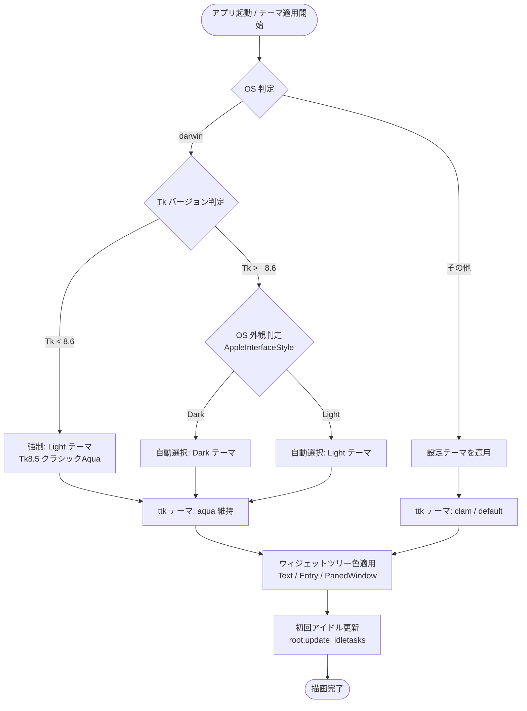

# 詳細設計書（マルチプラットフォームGUI描画とテーマ制御）
**標準Tkinterによるクロスプラットフォーム描画・Aqua制御・レガシー環境フォールバック仕様**

| 項目           | 内容                                                                     |
| :------------- | :----------------------------------------------------------------------- |
| 文書番号       | CLW-DD-004                                                               |
| ファイル名     | CLW-DD-004_マルチプラットフォームGUI描画とテーマ制御詳細設計書.md         |
| ドキュメント名 | マルチプラットフォームGUI描画とテーマ制御詳細設計書                      |
| 版数           | Rev.1.0                                                                  |
| 改訂日         | 2026-10-12                                                               |
| 作成日         | 2026-10-12                                                               |
| 作成者         | ClipWatcher Development Team                                             |

---

## 1. 概要と設計思想

### 1.1 標準モジュール縛り（ゼロインストールのポータビリティ）
本アプリケーションは、サードパーティ製GUIフレームワーク（PyQt, CustomTkinter等）や過度な外部依存を排し、**Python標準ライブラリ（`tkinter`, `ttk`）のみで完結するゼロインストール・高ポータビリティ**を基本設計思想とします。
ユーザーが追加の仮想環境やパッケージマネージャー（`uv`, `pip`）を意識することなく、OSに導入されている素の `python3 clip_watcher.py` だけで安全・快適に起動できることを目指します。

### 1.2 本書のスコープと単一責任 (SSOT)
本書は以下の制御仕様に関する正本（SSOT）を定義します：
1. **プラットフォーム別 ttk テーマの選定**: Windows, macOS (Aqua), Linux (clam/default) の描画パイプライン制御
2. **macOS Cocoa レンダリングと OS 外観同期**: システム外観（Dark/Light）とアプリ内カラーパレットの調和
3. **レガシーランタイム（Tk 8.5 / Python 3.9）フォールバック**: macOS 組み込みの Tk 8.5 環境における黒画面化防止と Light Aqua フォールバック
4. **ウィジェットツリーへのスタイル伝播**: `ThemeManager.apply_theme_to_widget_tree()` による Tk / ttk ウィジェットの色整合性担保

---

## 2. プラットフォーム別レンダリング仕様

| プラットフォーム | 使用テーマ | 背景・ウィジェット制御方針 | 留意点・制約 |
| :--- | :--- | :--- | :--- |
| **Windows** | `clam` / `default` | `ttk.Style` + ウィジェットツリー巡回でフルカラー制御 | ネイティブタイトルバーとの親和性良好 |
| **macOS (Tk 8.6+)** | `aqua` 維持 | OSダークモード判定と同期し、Dark/Lightパレット適用 | `clam`切り替え禁止（CALayer破壊防止） |
| **macOS (Tk 8.5)** | `aqua` 維持 | **強制的に Light テーマを適用**（クラシックAqua） | ダーク色適用禁止（Dark Mode非対応のため） |
| **Linux (X11)** | `clam` / `default` | `ttk.Style` + ウィジェットツリー巡回でフルカラー制御 | X11/Wayland環境依存なし |

### 2.1 macOS (Aqua) レンダリングの特殊性と制約
- **Cocoa ネイティブ描画**: macOS の `aqua` テーマは macOS の WindowServer / CALayer と直接連携して描画されます。`style.theme_use("clam")` 等を実行すると Cocoa サーフェスとの同期が外れ、ウィンドウ全体が黒一色（未描画）になります。そのため macOS では **`aqua` テーマの維持が必須** です。
- **システム外観との連動**: Tk 8.6.10+ の `aqua` は OS のシステムアピアランス（Dark / Light）に従って親フレームの背景色を自動決定します。アプリ側が OS と逆の明暗テーマを強制設定すると、親背景と文字色が同化して文字が消失（キメラ描画）するため、OS の外観（`defaults read -g AppleInterfaceStyle`）とテーマを一致させます。

### 2.2 Tk 8.5（macOS システム標準 Python 3.9）のフォールバック仕様
- **Tk 8.5 の特性**: macOS の Xcode CommandLineTools に付属する Python 3.9.6 にバンドルされた Tk 8.5 は、Dark Mode 導入前（macOS High Sierra 以前）の仕様であり、**白・シルバーの Light Aqua しか描画できません**。
- **フォールバック判定**: `sys.platform == "darwin"` かつ `tk.TkVersion < 8.6` を検知した場合、OS の外観が Dark Mode であっても **強制的に `theme = "light"` を適用** します。これにより、素の `python3 clip_watcher.py` 実行時でも描画破壊（黒画面化）を起こさず、正常に GUI が表示されます。

---

## 3. テーマ決定と描画制御フロー

---

## 4. モジュール・クラス詳細仕様

### 4.1 `ThemeManager` (`src/gui/theme_manager.py`)

#### A. `apply_theme(theme_name: str) -> None`
- **事前条件**: `self.root` が初期化済みであること。
- **処理手順**:
  1. `sys.platform == "darwin"` の場合：
     - `tk.TkVersion < 8.6` の判定を実施。
     - `TkVersion < 8.6` の場合は `theme_name = "light"` を強制設定。
     - `TkVersion >= 8.6` の場合は `is_macos_dark_mode()` に基づき `"dark"` または `"light"` を自動選択。
  2. `style = ttk.Style(self.root)` を取得。
  3. `sys.platform == "darwin"` かつ `"aqua" in style.theme_names()` の場合は `aqua` テーマを維持（`clam` への切替を行わない）。
  4. 各種 `ttk` スタイル（`TFrame`, `TLabel`, `TButton`, `Treeview` 等）にテーマ色を設定。
  5. `self.apply_theme_to_widget_tree(self.root, theme)` を呼び出し、非 ttk ウィジェットへ色を伝播。

#### B. `apply_theme_to_widget_tree(widget: tk.Widget, theme: dict) -> None`
- **対象ウィジェットと適用属性**:
  - `tk.Text`: `bg=theme["entry_bg"]`, `fg=theme["fg"]`, `insertbackground=theme["fg"]`, `selectbackground=theme["select_bg"]`, `selectforeground=theme["select_fg"]`
  - `tk.Entry` (`CustomEntry`): `bg=theme["entry_bg"]`, `fg=theme["fg"]`, `insertbackground=theme["fg"]`, `selectbackground=theme["select_bg"]`, `selectforeground=theme["select_fg"]`
  - `tk.PanedWindow`: `bg=theme["frame_bg"]`
  - `tk.Button`: `bg=theme["button_bg"]`, `fg=theme["button_fg"]`
  - `tk.Label`: `bg=theme["frame_bg"]`, `fg=theme["label_fg"]`

### 4.2 `PlatformUtils` (`src/utils/platform_utils.py`)

#### `is_macos_dark_mode() -> bool`
- **機能概要**: macOS のシステム外観設定がダークモードであるかを判定する。
- **実装方式**: `defaults read -g AppleInterfaceStyle` をサブプロセスで実行（タイムアウト 1.0秒）。標準出力が `"Dark"` の場合 `True`、それ以外（キー非存在、Lightモード、エラー時）は `False` を返却。

---

## 5. 初回描画の安定化契約 (Geometry & Idle Tasks)
macOS Tkinter では、ウィンドウ生成直後にイベントループへ入る際、ウィンドウの描画サーフェス（CALayer）の初期割り当てが遅延して黒い矩形が残る現象を防ぐため、以下の契約を義務付けます：
1. `ClipWatcherGUI.__init__` 完了直後に `master.update_idletasks()` を実行し、配置確定を強制する。
2. 診断ログ `[DIAG-GUI]` を出力し、Notebook タブ数およびルート子ウィジェット数を記録する。

---

## 6. 検証とテスト方針

1. **単体テスト (`tests/test_theme_manager.py`)**:
   - `TkVersion < 8.6` 模擬環境における `light` テーマ強制フォールバックの検証。
   - `sys.platform == "darwin"` における `aqua` テーマ維持の検証。
   - `tk.Entry` および `tk.PanedWindow` への色伝播の検証。
2. **実機検証マトリックス**:
   - macOS 標準 Python 3.9 (`/Library/Developer/CommandLineTools/usr/bin/python3`, Tk 8.5) での `python3 clip_watcher.py` 直接起動による正常描画。
   - Python 3.10+ (Tk 8.6.13+) 環境での Dark Mode / Light Mode 連動描画。
   - Windows 10/11 環境での既存テーマ動作の完全互換性。
