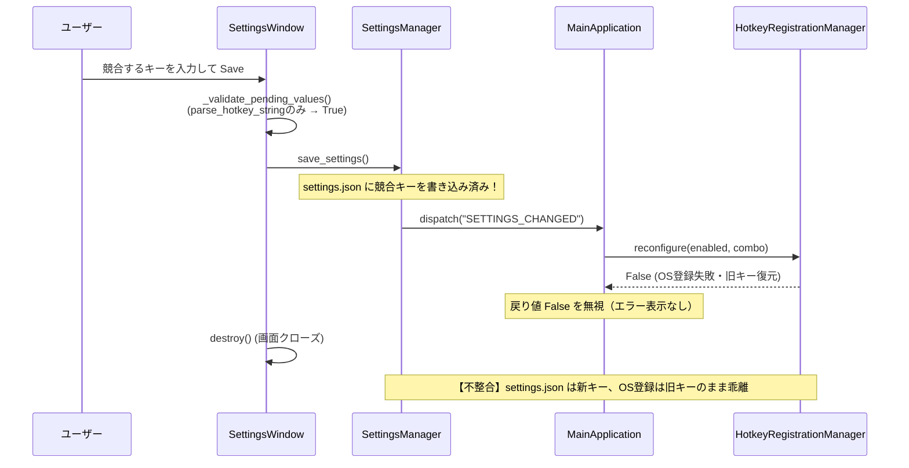

# 設計書群（CLW-BD-001〜CLW-DD-004）および実コード整合性 設計レビュー報告書

- **作成日**: 2026年11月4日
- **レビュー対象**: `docs/design/` 配下の全基本設計書・詳細設計書（`CLW-BD-001`〜`CLW-DD-004`）および対応する `src/` / `reusable_gui/` の実装コード

---

## 1. エグゼクティブサマリー（結論）

ClipWatcher のアーキテクチャは、`ApplicationBuilder` による DI（依存性注入）、`PlatformServices` による OS 抽象レイヤーの単一集約（Null アダプター廃止と明示的縮退）、`TextWorkflow` の Result パターン・プロセス隔離型 ReDoS 防御など、デスクトップアプリケーションとして高い保守性と安全性を備えています。特に 2026年8月31日の前回レビュー（`review_2026_08_31_maintenance_and_module_foundation_review.md`）で指摘された `TextWorkflow` の未実装項目（設定階層解決・UIスレッドマーシャリング・ReDoS対策・DI登録）はすべて解消されていることを確認しました。

一方で、**直近のマルチプラットフォーム拡張（macOS ホットキー対応、Treeview 移行、Tk 8.5 起動ガード等）に設計書の改訂が追いついていない箇所（SSOT間の矛盾）** と、**ホットキー設定変更時のロールバック契約破綻やマルチスレッド SQLite 接続などの設計・実装ギャップ** が検出されました。

### 優先対応サマリー

| 重要度 | ID | ステータス | 対象文書 / モジュール | 課題概要 |
| :---: | :--- | :---: | :--- | :--- |
| **High** | **F-01** | **完了** | `CLW-DD-001` §4.8 / `CLW-DD-002` §6.7 `app_main.py`, `settings_window.py` | **ホットキー競合時の失敗契約（設定非保存）の破綻**: `SettingsWindow._validate_pending_values()` で `hrm.reconfigure()` を試行し、失敗時にエラーダイアログを表示して保存中止する契約を復元。`MainApplication.on_settings_changed()` のデフォルト値も統一。 |
| **High** | **F-02** | **完了** | `CLW-BD-002` §2 / `CLW-DD-004` §2.2 `event_handlers/__init__.py`, `theme_manager.py` | **Tk 8.5 / Python 3.9 レガシー環境の扱いに関する方針矛盾**: PR #213 の実装に合わせて、Tk < 8.6 / Python < 3.10 は起動ガードでネイティブアラートを出して安全に終了する仕様へ設計書を改訂。 |
| **High** | **F-03** | **完了** | `CLW-DD-003` §4.5, §5.3 `text_workflow/history.py` | **TextWorkflow 履歴 DB のスレッド安全性と権限管理**: `ExecutionHistory` に `threading.Lock` を導入、DBファイル権限（`0o600`）設定、`TextWorkflowService.shutdown()` からのクローズ処理を追加。 |
| **Medium** | **F-04** | **完了** | `CLW-BD-002` §2 / `CLW-DD-001` §4.4 / `CLW-DD-002` §6.1 `platform/services.py`, `macos/hotkey.py` | **macOS ホットキー実装と Platform 層の境界不整合**: 設計書（BD-002, DD-001, DD-002）に macOS の `MacOSHotkeyListener`（Carbon API）をサポート対象として反映、`paste_sender.py` パスを修正。 |
| **Medium** | **F-05** | **完了** | `CLW-BD-001` §2.2, §5 / `CLW-DD-002` §3, §4 `clipboard_monitor.py`, `history_service.py` | **クリップボード監視・起動シーケンス図と実コードの乖離**: `HISTORY_UPDATED` イベントおよび `tk_root.after(0, _check_clipboard)` によるメインスレッド実行モデルに設計書のシーケンス図・記述を同期。 |
| **Medium** | **F-06** | **完了** | `CLW-DD-004` §4.1, §4.2 `theme_manager.py`, `history_list_component.py` | **GUI 描画仕様（Treeview・IconManager・フォント解決）の反映漏れ**: `ThemeManager` で `tk.Text` に `insertbackground` を設定。DD-004 に `History.Treeview`、`IconManager`、`resolve_safe_font_family` を追記。 |
| **Low** | **F-07** | **完了** | `CLW-DD-003` §4.1, §4.5 `text_workflow/workflow.py`, `clipboard_monitor.py` | **設定反映漏れとデッドコード**: `TextWorkflow.execute()` で `history.enabled` 設定を参照。`ClipboardMonitor` の不要な5秒空ポーリングタイマー（`_schedule_auto_save_check`）を削除。 |

---

## 2. 個別設計書レビュー結果（文書別評価）

### 2.1 `CLW-BD-001`: ClipWatcher全体アーキテクチャ基本設計書 (Rev.1.2)

- **評価**: 全体構造、コマンドパターン（`UndoManager` の `maxlen=100`）、DB層のセキュリティ堅牢化（パーミッション `0o700`/`0o600`、DAOのINSERT/UPDATE分離、DTO検証、シンボリックリンク拒否）が的確に文書化されている。
- **指摘事項**:
  1. **サブパッケージ記載漏れ (§2.1)**: `src/core/` 配下に存在する `platform/`、`hotkey/`、`window/`、`text_workflow/` が §2.1 のディレクトリ構成に含まれていない。
  2. **架空のサービス名 (§2.1)**: `src/services/` の例として `FixedPhrasesManager` が挙げられているが、実装には存在しない（実装は `MetaPhraseDAO` / `CategoryDAO` と `NotificationManager`, `TextWorkflowService`）。
  3. **イベント名の乖離 (§2.2, §5)**: `ClipboardMonitor` が `CLIPBOARD_CHANGED` を発行して `MainApplication` が購読する図・表になっているが、実装では `ClipboardMonitor` → `HistoryService.add_history_item()` → `EventDispatcher.dispatch("HISTORY_UPDATED", ...)` の経路をとっている（詳細は **F-05**）。

### 2.2 `CLW-BD-002`: ClipWatcher機能基本設計書 (Rev.1.5)

- **評価**: マルチプラットフォーム方針（ゼロインストール原則、`PlatformServices` 集約、`UnsupportedFeatureError` による明示的縮退、`StartupController` のセキュリティ刷新）が明確に定義されている。
- **指摘事項**:
  1. **Python 3.9 / Tk 8.5 の動作前提矛盾 (§2)**: 「macOS レガシー環境 Python 3.9 / Tk 8.5 での起動もフォールバックにより許容」とあるが、実コードの `start_app()` は Tk 8.5 および Python 3.10 未満を検知するとエラーを表示して終了する（詳細は **F-02**）。
  2. **グローバルホットキーの対応OS記述 (§2)**: 「ホットキーは現行Windows限定とし、非対応環境ではUI上で明示的に案内しバリデーションで弾く」とあるが、現在は macOS（Carbon `RegisterEventHotKey`）も実装・有効化されている（詳細は **F-04**）。

### 2.3 `CLW-DD-001`: 設定画面スキーマ駆動化とグローバルホットキー連携詳細設計書 (Rev.1.0)

- **評価**: `ReusableSettingsWindow` と `PluginSettingsSchemaProvider` を用いたスキーマ合成、`WindowStateManager` の Strategy パターン、`HotkeyRegistrationManager` による集合登録とロールバック設計が整理されている。
- **指摘事項**:
  1. **Apply/Save 時の競合検証・失敗契約の乖離 (§3.2, §4.6.4, §4.8)**: DD-001 は「Apply/Save時に `HotkeyRegistrationManager` で競合確認を行い、失敗時はエラーを表示して設定を保存しない」と定義しているが、Issue #141（DD-002 §6.7）で `_validate_pending_values()` から OS 登録処理を除外した結果、**競合時のエラー通知も設定保存の中止も行われなくなっている**（詳細は **F-01**）。
  2. **ファイル配置の乖離 (§4.4, §5)**: `src/core/hotkey/paste_sender.py`（`WindowsPasteSender`）が記載されているが、実装では `src/core/platform/windows/paste_sender.py` へ移動済みである。
  3. **デフォルトキーと修飾キー仕様 (§4.1, §4.5.2)**: macOS 対応に伴い、macOS でのデフォルトは `Cmd+Shift+F`、修飾キーに `Cmd` / `Opt` が追加されているが、DD-001 は Rev.1.0（2026-08-31）のまま更新されていない。

### 2.4 `CLW-DD-002`: コア層起動監視イベント制御詳細設計書 (Rev.1.5)

- **評価**: `PlatformServices` の契約、例外階層（`PlatformError` / `UnsupportedFeatureError` / `SingleInstanceError`）、各アダプターの縮退仕様が具体的でテスト要件まで一貫している。
- **指摘事項**:
  1. **起動シーケンス図の順序と責務 (§3)**:
     - 図では `Start` が `app.run()` を呼び、`App` が `ClipboardMonitor.start()` と `GUI.mainloop()` を呼ぶように描かれているが、実装では `ApplicationBuilder.build()` 内で `settings_manager.load_and_notify()` と `app.on_ready()`（内部で `monitor.start()`）まで完了し、`start_app()` が `root.mainloop()` を呼んでいる（`app.run()` メソッドは存在しない）。
     - `ClipWatcherGUI` は `ApplicationBuilder` が直接構築するのではなく、`MainApplication.__init__()` 内で生成されている。
  2. **監視スレッドと Tkinter スレッドの関係 (§4)**:
     - 図では別スレッドの `ClipboardMonitor` が `_check_clipboard()` で OS と DB を直接操作するように描かれているが、実装ではワーカースレッドは `time.sleep(0.5)` ごとに `self.tk_root.after(0, self._check_clipboard)` をスケジュールするのみで、**実際のクリップボード読み取り・プロセス判定・DB書き込みはすべて Tkinter メインスレッド上で同期実行**されている（詳細は **F-05**）。
  3. **macOS `HotkeyListener` の表記載漏れ (§6.1, §6.2, §6.5)**:
     - §6.1 の表で macOS の `HotkeyListener` が `非対応 (UnsupportedFeatureError)` となっているが、実装（`services.py` L149-152）では `MacOSHotkeyListener` を返している（詳細は **F-04**）。

### 2.5 `CLW-DD-003`: TextWorkflow詳細設計書 (Rev.1.5)

- **評価**: 前回レビュー（2026-08-31）の指摘事項がすべて反映され、公開 API（`__all__`）、拡張点（`ports.py` / `ConfigurationResolver` / `ExecutionHistory`）、Result パターンによる例外非伝播、`workspace_root` の UNC パス拒否・セキュリティパラメータ緩和禁止（#175）、`multiprocessing`（`spawn`）による ReDoS 隔離など、設計書とコードの一致度が非常に高い。
- **指摘事項**:
  1. **履歴 DB のマルチスレッド排他制御とクローズ漏れ (§4.5, §5.3)**: `ExecutionHistory` が `check_same_thread=False` の単一コネクションをロックなしで複数ワーカーから共有している点、および `TextWorkflowService.shutdown()` で DB 接続が閉じられない点（詳細は **F-03**）。
  2. **`history` 設定の未連携 (§4.1, §4.5)**: `DEFAULT_BUILTIN_CONFIG` に定義されている `history.enabled` と `history.maxRecords` が `TextWorkflow.execute()` / `ExecutionHistory` に反映されていない（詳細は **F-07**）。
  3. **フロントマターの `version` / `updated_at`**: 改訂履歴は `Rev.1.5`（`2026-10-15`）まで追記されているが、YAML フロントマターと冒頭表が `version: "1.0"`, `updated_at: "2026-08-31"` のままになっている（`CLW-BD-001` も同様）。

### 2.6 `CLW-DD-004`: マルチプラットフォームGUI描画とテーマ制御詳細設計書 (Rev.1.0)

- **評価**: macOS Aqua と `clam` テーマの競合による黒画面化メカニズム、OS 外観同期、初回描画の `update_idletasks()` 契約など、Tkinter 特有のプラットフォーム制約が明確に言語化されている。
- **指摘事項**:
  1. **Tk 8.5 フォールバック仕様と `start_app()` 実装の矛盾 (§1.2, §2.2, §3, §4.1)**: 設計書の中心テーマの一つである「Tk 8.5 環境での Light テーマ強制フォールバックによる正常起動」が、`start_app()` 側の起動ブロック処理によって到達不能になっている（詳細は **F-02**）。
  2. **`apply_theme_to_widget_tree` の色定義の乖離 (§4.1 B)**: 設計書と `src/gui/theme_manager.py` の実際の設定値が複数箇所で不一致（詳細は **F-06**）。
  3. **Treeview / IconManager / フォント解決仕様の未記載**: Issue #195, #196, #197, #203, #212 で導入された重要設計が未反映（詳細は **F-06**）。

---

## 3. 主要な設計課題の詳細と改善提案

### [F-01] (High) ホットキー設定変更時の失敗契約破綻とデフォルト値の不整合

#### 現状の問題
1. **設計書間の矛盾と契約破綻**:
   - [CLW-DD-001 §4.8](file:///Users/saigoutsubasa/Desktop/python/Clip_Watcher/docs/design/CLW-DD-001_設定画面スキーマ駆動化とグローバルホットキー連携詳細設計書.md#L409-L416) では、「Apply/Save時に新しいキーが競合した場合、エラーを表示してApply/Saveを中止する。候補設定は `settings.json` に保存せず、従来の有効なホットキー登録を維持・復元する」と定義されています。
   - 一方、[CLW-DD-002 §6.7](file:///Users/saigoutsubasa/Desktop/python/Clip_Watcher/docs/design/CLW-DD-002_コア層起動監視イベント制御詳細設計書.md#L230-L235)（#141）では、検証時の副作用を防ぐために [`SettingsWindow._validate_pending_values()`](file:///Users/saigoutsubasa/Desktop/python/Clip_Watcher/src/gui/windows/settings_window.py#L49-L88) を構文解析（`parse_hotkey_string()`）のみに限定し、実際の OS 登録（`reconfigure()`）は `SETTINGS_CHANGED` イベント受信時の [`MainApplication.on_settings_changed()`](file:///Users/saigoutsubasa/Desktop/python/Clip_Watcher/src/core/app_main.py#L352-L355) で行うよう変更されました。
   - しかし、[`ReusableSettingsWindow._save_and_close()`](file:///Users/saigoutsubasa/Desktop/python/Clip_Watcher/reusable_gui/windows/settings_window.py) は `_validate_pending_values()` が `True` を返すと即座に `settings_manager.save_settings()`（ファイル書き込み＋`SETTINGS_CHANGED` 発火）を実行してウィンドウを閉じます。さらに `MainApplication.on_settings_changed()` の L355 では `self.hotkey_registration_manager.reconfigure(hotkey_enabled, hotkey_combo)` の**戻り値（`bool`）を完全に無視**しています。
   - 結果として、**他アプリと競合するキーを設定画面で指定して Save すると、エラーダイアログは一切表示されず、OS 登録は旧キーにロールバックされるのに `settings.json` には競合する新キーが保存されてしまう**（次回起動時に初めて競合エラーになる）という状態不整合が発生します。
2. **フォールバック既定値の不整合**:
   - [`MainApplication.on_settings_changed()`](file:///Users/saigoutsubasa/Desktop/python/Clip_Watcher/src/core/app_main.py#L353-L355) では `settings.get("global_hotkey_enabled", False)` / `settings.get("global_hotkey_combo", "Ctrl+Shift+V")` となっていますが、[`defaults.py`](file:///Users/saigoutsubasa/Desktop/python/Clip_Watcher/src/core/config/defaults.py) および `MainApplication.on_ready()`（L118, L271-272）では `True` / `"Ctrl+Shift+F"`（macOS は `"Cmd+Shift+F"`）です。

#### 改善提案
- **案A（推奨・DD-001 の失敗契約を維持しつつ #141 の副作用分離を満たす）**:
  - `SettingsWindow._validate_pending_values()` の最後に（他の全フィールドの検証が通った後でのみ）、`hrm.reconfigure(enabled, combo)` を試行する。失敗時はエラーダイアログを出して `False` を返し、保存を中止する（`reconfigure` 自身が失敗時に旧登録を復元するため副作用は残らない）。
- **案B（イベント駆動を維持する場合）**:
  - `MainApplication.on_settings_changed()` で `reconfigure()` が `False` を返した場合に `show_error_message()` でユーザーへ通知し、`settings_manager` の `global_hotkey_combo` / `global_hotkey_enabled` を `hrm.current_combo` / `hrm.current_enabled` へ巻き戻して再保存する。
- あわせて `MainApplication.on_settings_changed()` L353-354 のデフォルト値を `defaults.DEFAULT_USER_SETTINGS` と統一してください。

---

### [F-02] (High) Tk 8.5 / Python 3.9 レガシー環境の扱いに関する設計書と実装の矛盾

#### 現状の問題
- [CLW-BD-002 §2](file:///Users/saigoutsubasa/Desktop/python/Clip_Watcher/docs/design/CLW-BD-002_ClipWatcher機能基本設計書.md#L39) では「対象ランタイム: Python 3.10 以降（macOS レガシー環境 Python 3.9 / Tk 8.5 での起動もフォールバックにより許容）」と定義され、[CLW-DD-004 §2.2, §3, §4.1](file:///Users/saigoutsubasa/Desktop/python/Clip_Watcher/docs/design/CLW-DD-004_マルチプラットフォームGUI描画とテーマ制御詳細設計書.md#L59-L61) でも Tk 8.5 環境で Light テーマを強制適用して起動する仕様が詳細に定義されています。[`ThemeManager.apply_theme()`](file:///Users/saigoutsubasa/Desktop/python/Clip_Watcher/src/gui/theme_manager.py#L48-L54) にもそのコードが存在します。
- しかし、直近の PR #213（Issue #211）で更新された [`src/event_handlers/__init__.py` (`start_app`)](file:///Users/saigoutsubasa/Desktop/python/Clip_Watcher/src/event_handlers/__init__.py#L153-L195) では、`is_legacy_macos_tk()`（Tk < 8.6）または `sys.version_info < (3, 10)` を検出した時点で、**「本アプリケーションの動作には Tk 8.6 以上 (Python 3.10+) が必要です」というネイティブアラート（`osascript`）またはエラーダイアログを表示して `root.destroy(); return` で終了する実装**になっています。
- このため、`ThemeManager` 内の `tk_ver < 8.6` 分岐や `apply_macos_aqua_appearance()` は本番起動フローにおいてデッドコード（起動終了直前に呼ばれるのみ）となっており、設計書（BD-002 / DD-004）の記述と正反対の挙動になっています。

#### 改善提案
- 製品方針として「Tk 8.5 / Python 3.9 は CoreAnimation 非対応のためサポート外とし、明示的エラーで安全に終了する（PR #213 の実装を正とする）」のであれば、以下を実施してください：
  1. `CLW-BD-002` §2 の「Python 3.9 / Tk 8.5 での起動もフォールバックにより許容」を「macOS システム標準の Python 3.9 / Tk 8.5 環境で実行された場合は、黒画面化を防ぐためネイティブアラートで Python 3.10+ / Tk 8.6+ への誘導を表示して安全に終了する」へ更新する。
  2. `CLW-DD-004` の §1.2, §2, §2.2, §3（Mermaid図）, §4.1, §6 を「レガシー環境検知時の即時起動ガード仕様」へ改訂する。

---

### [F-03] (High) `TextWorkflow` の `ExecutionHistory` における SQLite スレッド安全性・権限・リソース解放

#### 現状の問題
1. **スレッド安全性**:
   - [`ExecutionHistory.__init__()`](file:///Users/saigoutsubasa/Desktop/python/Clip_Watcher/src/core/text_workflow/history.py#L16) は `self._conn = sqlite3.connect(self._db_path, check_same_thread=False)` として単一のコネクションを保持し、[`record()`](file:///Users/saigoutsubasa/Desktop/python/Clip_Watcher/src/core/text_workflow/history.py#L34-L70) や [`get_recent()`](file:///Users/saigoutsubasa/Desktop/python/Clip_Watcher/src/core/text_workflow/history.py#L72-L97) で `threading.Lock` なしに `with self._conn:` を実行しています。
   - 一方、[`TextWorkflowService`](file:///Users/saigoutsubasa/Desktop/python/Clip_Watcher/src/services/text_workflow_service.py#L46) は `ThreadPoolExecutor(max_workers=2)` で `TextWorkflow.execute()` を並行実行します。2つのワーカースレッドが同時に `self._history.record()` に入ると、単一コネクション上でトランザクションが衝突し `sqlite3.OperationalError: cannot start a transaction within a transaction` 等で失敗する恐れがあります。
   - 対照的に、本体側の [`DatabaseManager`](file:///Users/saigoutsubasa/Desktop/python/Clip_Watcher/src/db/database_manager.py#L27) / `BaseDAO` は `threading.Lock` と操作ごとのコネクション生成で安全に実装されています。
2. **リソース解放漏れ**:
   - `ExecutionHistory.close()` メソッドは用意されていますが、`TextWorkflowService.shutdown()` から呼び出されていません。
3. **DB ファイルのアクセス権限**:
   - [CLW-BD-001 §8](file:///Users/saigoutsubasa/Desktop/python/Clip_Watcher/docs/design/CLW-BD-001_ClipWatcher全体アーキテクチャ基本設計書.md#L129) ではクリップボードデータを扱う SQLite ファイルに `0o600` 権限を強制していますが、`text_workflow_history.db` には `input_text` / `output_text`（クリップボード由来の機密テキストを含む）が保存されるにもかかわらず、`0o600` の権限設定が行われていません。

#### 改善提案
- `ExecutionHistory` に `self._lock = threading.Lock()` を導入し、`_init_db()`, `record()`, `get_recent()`, `close()` を `with self._lock:` で保護する。
- ファイルパスが `:memory:` 以外の場合は `DatabaseManager` と同様に `0o600` パーミッションを設定する。
- `TextWorkflowService.shutdown()` の末尾（またはワーカー完了後）で `self._workflow` 経由または注入された `history.close()` を呼び出すライフサイクルを追加する。

---

### [F-04] (Medium) macOS グローバルホットキー対応に伴う設計書更新漏れと Platform 層の責務境界

#### 現状の問題
1. **設計書の未更新**:
   - [`src/core/platform/macos/hotkey.py`](file:///Users/saigoutsubasa/Desktop/python/Clip_Watcher/src/core/platform/macos/hotkey.py) に Carbon `RegisterEventHotKey` を用いた `MacOSHotkeyListener` が実装され、[`PlatformServices.create_hotkey_listener()`](file:///Users/saigoutsubasa/Desktop/python/Clip_Watcher/src/core/platform/services.py#L149-L152) や [`SettingsManager._get_hotkey_label()`](file:///Users/saigoutsubasa/Desktop/python/Clip_Watcher/src/core/config/settings_manager.py#L22-L26) でも macOS がサポート対象になっています。
   - しかし、`CLW-BD-002` §2、`CLW-DD-001` 全般、`CLW-DD-002` §6.1 / §6.2 / §6.5 ではすべて「ホットキーは Windows 限定（macOS / Linux は `UnsupportedFeatureError`）」と記述されたままです。
2. **パッケージ間の責務境界のねじれ**:
   - [CLW-DD-002 §6](file:///Users/saigoutsubasa/Desktop/python/Clip_Watcher/docs/design/CLW-DD-002_コア層起動監視イベント制御詳細設計書.md#L152) は「OSごとに実装が異なる機能は `src/core/platform/` に隔離し、各クラスが `sys.platform` で分岐しない」と定めています。
   - しかし実際には：
     - Windows 用の `GlobalHotkeyListener` は `src/core/hotkey/global_hotkey_listener.py` に置かれ、macOS 用の `MacOSHotkeyListener` は `src/core/platform/macos/hotkey.py` に置かれており、さらに `MacOSHotkeyListener` が `src/core/hotkey/global_hotkey_listener.py` から `GLOBAL_HOTKEY_ID`, `HotkeyRegistration` を import しています（`platform/` アダプターが `platform/protocols.py` 以外に依存しないという DD-002 §6.7 の原則に違反）。
     - `global_hotkey_listener.py` 内に Win32 定数（`MOD_CONTROL` 等）と macOS Carbon 定数（`DARWIN_CMD`, `_DARWIN_KEY_MAP` 等）および `sys.platform == "darwin"` 分岐が混在しています。

#### 改善提案
- **ドキュメント更新**: `CLW-BD-002`、`CLW-DD-001`、`CLW-DD-002` §6.1 の対応表において、macOS の `HotkeyListener` を `MacOSHotkeyListener (Carbon RegisterEventHotKey)` として明記し、非対応環境を「Linux 等」に修正する。また DD-001 §4.4 の `paste_sender.py` のパスを `src/core/platform/windows/paste_sender.py` 等に修正する。
- **モジュール境界の整理（リファクタリング案）**:
  - `GLOBAL_HOTKEY_ID` と `HotkeyRegistration` を `src/core/platform/protocols.py`（または `src/core/hotkey/models.py`）へ配置し、`WindowsHotkeyListener` を `src/core/platform/windows/hotkey.py` へ移動することで、`src/core/hotkey/` を OS 非依存のキー文字列解析・登録集合管理（`HotkeyRegistrationManager`）のみに純化する。

---

### [F-05] (Medium) クリップボード監視・イベントデータフローの設計書と実装の乖離

#### 現状の問題
1. **イベント名の不一致**:
   - `CLW-BD-001` §2.2, §5 および `CLW-DD-002` §4 では、`ClipboardMonitor` が `CLIPBOARD_CHANGED` イベントを発行すると記載されていますが、実装コード全体（`src/`）に `CLIPBOARD_CHANGED` というイベントは存在しません。
   - 実装では、`ClipboardMonitor` が `self.history_service.add_history_item(clipboard_data)` を直接呼び出し、`HistoryService._notify_updated()` が `HISTORY_UPDATED` イベント（ペイロード: `{"last_content": ..., "history": ...}`）を `EventDispatcher` へ発行しています。
2. **スレッドモデルと DB 依存の記述ギャップ**:
   - `CLW-DD-002` §4 では「`ClipboardMonitor` は別スレッドで稼働し、OSクリップボード確認・除外アプリ判定・DB保存を行った上でイベントを発行する」と図示されています。
   - しかし [`ClipboardMonitor._monitor_clipboard()`](file:///Users/saigoutsubasa/Desktop/python/Clip_Watcher/src/core/clipboard/clipboard_monitor.py#L137-L152) の実装は、バックグラウンドスレッドで 0.5 秒ごとに `self.tk_root.after(0, self._check_clipboard)` を呼ぶだけであり、**`_check_clipboard()`（`clipboard_get()` / `pbpaste` サブプロセス起動 / `osascript` 等によるアクティブプロセス取得 / SQLite への INSERT）はすべて Tkinter の GUI メインスレッド上で実行**されています。
   - Tkinter の `clipboard_get()` を呼ぶためにメインスレッドで実行する合理的な理由はありますが、フォールバックの `pbpaste`（最大1秒タイムアウト）や `ProcessInspector`（外部コマンド実行時）が発火した際、GUI メインスレッドが一時的にブロックされる特性があります。また、`ClipboardMonitor.__init__` は `db_manager` を受け取って `self.db_manager` に保持していますが、クラス内で一度も使用していません（履歴操作はすべて `history_service` 経由）。

#### 改善提案
- `CLW-BD-001` §2.2, §5 および `CLW-DD-002` §3, §4 のシーケンス図・イベント一覧表を、実装の `ClipboardMonitor` → `HistoryService` → `EventDispatcher("HISTORY_UPDATED")` → `MainApplication._on_history_updated_event()` に合わせて更新する。
- `CLW-DD-002` §4 に、Tkinter のスレッド制約から `_check_clipboard` を `tk_root.after(0, ...)` でメインスレッド実行している旨を明記する。
- `ClipboardMonitor.__init__` から未使用の `db_manager`（および JSON 時代の `history_file_path`）引数を段階的に整理する（DD-002 §6.6a の「`ClipboardMonitor` は監視・変更検知・書き込みに専念」の方針を完結させる）。

---

### [F-06] (Medium) `CLW-DD-004` における GUI 描画仕様（Treeview・IconManager・色設定）の反映漏れ

#### 現状の問題
1. **`apply_theme_to_widget_tree` の仕様不一致 (`CLW-DD-004` §4.1 B vs `src/gui/theme_manager.py`)**:
   - `tk.Text`: DD-004 は `bg=theme["entry_bg"], fg=theme["fg"], insertbackground=theme["fg"]` と記載しているが、実装（L279-285）は `(tk.Text, tk.Listbox)` として `bg=theme["listbox_bg"], fg=theme["listbox_fg"]` を設定し、`insertbackground` を設定していない（結果としてダークモード時に `CustomText` のキャレットが見えにくくなる可能性がある）。
   - `tk.Label`: DD-004 は `bg=theme["frame_bg"]` と記載しているが、実装（L301-302）は `bg=theme["bg"]`。
   - `tk.Entry`: DD-004 は `fg=theme["fg"]` と記載しているが、実装（L274）は `fg=theme["entry_fg"]`。
2. **直近の重要アーキテクチャ変更の未反映**:
   - **Treeview 移行とスタイル制御**: 履歴一覧が `tk.Listbox` から `ttk.Treeview`（専用スタイル `History.Treeview`）へ移行済みであり、macOS Aqua での `systemHighlight` / `systemHighlightText` マッピング（#196）、Windows/Linux `clam` ダークモードでの `pinned` タグ背景色保護ワークアラウンド、`"history_item"` タグによる Aqua フォント適用と `rowheight` 動的計算（#195）が実装されているが、DD-004 に記載がない。
   - **`IconManager` とピン留め表示フォールバック (#203, #212)**: `IconManager` の世代番号（`cache_generation`）によるテーマ切替時の画像再バインドや、画像未取得時の `📌` テキストフォールバック（#212）が DD-004（および BD-001 §3/§4）に記載されていない。
   - **クロスプラットフォーム安全フォント解決 (#197)**: `PlatformUtils.resolve_safe_font_family()` が DD-004 §4.2 に未記載。

#### 改善提案
- `CLW-DD-004` を Rev.1.1 へ改訂し、`History.Treeview` のスタイル制御、`IconManager` 連携、`resolve_safe_font_family()` を §4 に追記する。
- `ThemeManager.apply_theme_to_widget_tree()` の `tk.Text` に `insertbackground=theme["fg"]` を追加してダークモード時のキャレット視認性を確保した上で、DD-004 §4.1 B の表と実装を一致させる。

---

### [F-07] (Low) `TextWorkflow` の履歴設定未連携および `ClipboardMonitor` のレガシーコード残存

#### 現状の問題
1. **`TextWorkflow` の `history` 設定**:
   - [`config_resolver.py`](file:///Users/saigoutsubasa/Desktop/python/Clip_Watcher/src/core/text_workflow/config_resolver.py#L41-L44) の `DEFAULT_BUILTIN_CONFIG` には `"history": {"enabled": True, "maxRecords": 500}` が定義されていますが、[`TextWorkflow.execute()`](file:///Users/saigoutsubasa/Desktop/python/Clip_Watcher/src/core/text_workflow/workflow.py#L128) は `if request.save_history:` のみを判定しており、`config.get("history", {}).get("enabled", True)` を参照していません。また `maxRecords` も `ExecutionHistory` へ渡されていません。
2. **`ClipboardMonitor` の空ポーリングタイマー**:
   - [`ClipboardMonitor`](file:///Users/saigoutsubasa/Desktop/python/Clip_Watcher/src/core/clipboard/clipboard_monitor.py#L273-L295) には JSON ファイル保存時代の `_schedule_auto_save_check()` / `_auto_save_check()`（5秒ごとに何もせず再スケジュールするだけの Tkinter タイマー）や `save_history_to_file()`（no-op）が残存しており、`MainApplication.shutdown()` からも呼ばれています。

#### 改善提案
- `TextWorkflow.execute()` の履歴保存判定を `if request.save_history and config.get("history", {}).get("enabled", True):` とし、設定ファイルの `history.enabled` が機能するようにする。
- 既存テストが `save_history_to_file()` 等をモックしていないか確認した上で、`ClipboardMonitor` の不要な5秒タイマー（`_schedule_auto_save_check`）を削除する。

---

## 4. 推奨アクションプラン（優先順位）

1. **[優先度1: High] ホットキー登録失敗時の契約修正とデフォルト値統一 (F-01)**
   - `SettingsWindow` または `MainApplication.on_settings_changed()` で `reconfigure()` 失敗時のエラー通知・設定ロールバックを実装し、`CLW-DD-001` §4.8 と `CLW-DD-002` §6.7 の記述を統一する。
2. **[優先度2: High] `ExecutionHistory` のスレッドロック・ファイル権限・クローズ処理の追加 (F-03)**
   - `src/core/text_workflow/history.py` に `threading.Lock` と `0o600` 権限設定を導入し、`TextWorkflowService.shutdown()` からクローズする。
3. **[優先度3: High/Medium] 設計書群（BD-001, BD-002, DD-001, DD-002, DD-004）の最新実装への同期 (F-02, F-04, F-05, F-06)**
   - Tk 8.5 / Python 3.9 起動ガード仕様の反映（BD-002, DD-004）。
   - macOS ホットキー対応と `paste_sender.py` パスの反映（BD-002, DD-001, DD-002）。
   - `HISTORY_UPDATED` イベントと監視スレッド図の修正（BD-001, DD-002）。
   - `History.Treeview` / `IconManager` / `resolve_safe_font_family` の追記（BD-001, DD-004）。
4. **[優先度4: Low] `TextWorkflow` の `history.enabled` 連携と不要タイマー整理 (F-07)**
   - `workflow.py` での `history.enabled` 参照追加と `ClipboardMonitor._schedule_auto_save_check` の廃止。

---

## 5. 対応完了記録（2026-11-04）

本報告書で検出された課題（F-01 〜 F-07）について、コード修正および設計書改訂をすべて実施・検証しました。

### 5.1 コード変更内容
1. **[F-01] ホットキー失敗契約の復元とデフォルト値統一**:
   - `src/gui/windows/settings_window.py`: `_validate_pending_values()` で構文チェック通過後に `hrm.reconfigure(enabled, combo)` を試行し、OS登録失敗時（競合時等）にエラーダイアログを表示して保存・画面終了を中止する契約を復元。
   - `src/core/app_main.py`: `on_settings_changed()` のデフォルト値を `DEFAULT_USER_SETTINGS`（Windows: `Ctrl+Shift+F`, macOS: `Cmd+Shift+F`）に統一し、再構成失敗時のログ出力およびエラーダイアログ通知を追加。
   - `tests/test_settings_window_schema.py`: 競合時の保存中止および成功時の再構成テストを追加。
2. **[F-03] `ExecutionHistory` のスレッドセーフ化・権限・リソース解放**:
   - `src/core/text_workflow/history.py`: `threading.Lock` を導入して `_init_db`, `record`, `get_recent`, `close` を排他的に保護。DBファイル作成時に `0o600`（POSIX環境）のパーミッションを設定。
   - `src/core/text_workflow/workflow.py`: `close()` メソッドを追加し、保持する履歴DB接続をクローズ可能化。
   - `src/services/text_workflow_service.py`: `shutdown()` の末尾で `workflow.close()` を呼び出し、アプリ終了時にリソースを確実に解放。
   - `tests/unit/test_text_workflow.py`: マルチスレッド同時書き込み・`0o600` 権限・クローズ後の安全動作・`shutdown` クローズ呼び出しの検証テストを追加。
3. **[F-06] `ThemeManager` の `tk.Text` キャレット色修正**:
   - `src/gui/theme_manager.py`: `apply_theme_to_widget_tree()` において `tk.Text` と `tk.Listbox` を分離し、`tk.Text` に `insertbackground=theme["fg"]` を設定。
   - `tests/test_theme_manager.py`: `tk.Text` への `insertbackground` 適用テストを追加。
4. **[F-07] `TextWorkflow` 設定連携と `ClipboardMonitor` タイマー削除**:
   - `src/core/text_workflow/workflow.py`: `request.save_history and config.get("history", {}).get("enabled", True)` の判定を追加し、設定ファイルからの履歴無効化を有効化。
   - `src/core/clipboard/clipboard_monitor.py`: 不要な5秒空ポーリングタイマー（`_auto_save_interval_ms`, `_schedule_auto_save_check`, `_auto_save_check`）および未使用の `_dirty` 属性を完全削除。

### 5.2 設計書改訂内容
- **`CLW-BD-001` (Rev.1.3)**: コア層サブパッケージ（`platform/`, `hotkey/`, `window/`, `text_workflow/`）を反映、`HISTORY_UPDATED` へのデータフロー是正、Treeview/IconManager/TextWorkflowService 追記。
- **`CLW-BD-002` (Rev.1.6)**: macOS Tk 8.5 / Python 3.9 起動ガード（#213）の反映、macOS グローバルホットキー対応（Carbon API）を反映。
- **`CLW-DD-001` (Rev.1.1)**: macOS デフォルトキー（`Cmd+Shift+F`）、`PasteSender` 配置パス是正、Apply/Save 競合失敗契約（F-01）の明記。
- **`CLW-DD-002` (Rev.1.6)**: 起動シーケンス、監視スレッド（`tk_root.after(0)` によるメインスレッド実行モデル）、`HISTORY_UPDATED` フロー是正、macOS `MacOSHotkeyListener` 表記追加、設定検証契約是正。
- **`CLW-DD-003` (Rev.1.6)**: `ExecutionHistory` のスレッドセーフ化・`0o600` 権限管理・`shutdown()` クローズ契約・`history.enabled` 設定連携を追記。
- **`CLW-DD-004` (Rev.1.1)**: Tk 8.5 起動ガード仕様（#213）、Treeview/IconManager/フォント解決仕様の追記、`apply_theme_to_widget_tree` 表の実装整合。
